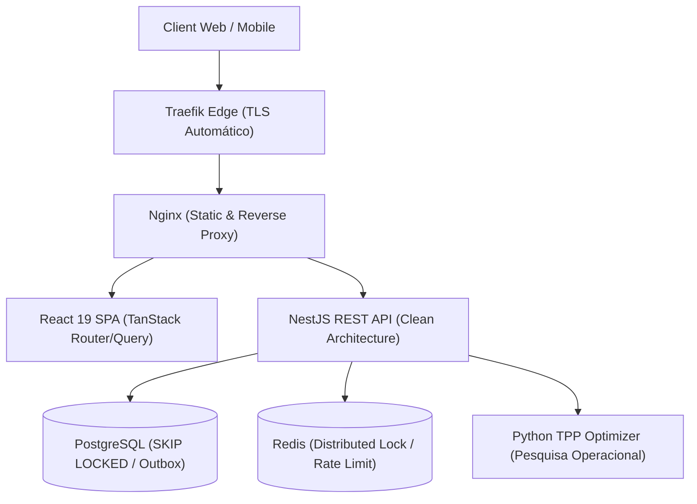

# Olá, sou Pedro Alberto Pontes 👋

### Software Engineer | Full-Stack Developer | Distributed Systems & Clean Architecture

Engenheiro de Software com foco em sistemas web escaláveis, APIs de alta confiabilidade e arquiteturas orientadas a eventos. Experiência sólida no ecossistema **TypeScript (Node.js/NestJS, React 19)** e **Python**, atuando desde a modelagem relacional avançada e controle de concorrência em bancos de dados até a orquestração de microsserviços conteinerizados e interfaces reativas de alto desempenho.

📄 **[Visualizar meu Currículo em PDF](./Curriculo_Pedro_Alberto.pdf)** • 🌐 **[Versão Web Interativa (HTML)](./Curriculo_Pedro_Alberto.html)**

---

### 🚀 Destaques de Engenharia & Especialidades

- **Controle de Concorrência & Mensageria**: Implementação de Outbox Pattern, processamento transacional seguro com `FOR UPDATE SKIP LOCKED` em PostgreSQL e Distributed Locks via Redis.
- **Engenharia de Qualidade & Testes**: Cultura rigorosa de testes automatizados com Jest, Vitest e Pytest — mais de **480 testes em produção** cobrindo regras de negócio e fluxos críticos.
- **Arquitetura & Resiliência**: Clean Architecture, Domain-Driven Design (DDD), autenticação revogável (JWT blacklist por `jti`), rate limiting fail-closed e mitigação de vulnerabilidades OWASP.
- **DevOps & Edge Routing**: Orquestração com Docker, Traefik (TLS automático), Nginx e padronização de Developer Experience (DX) via automações em Makefile.

---

### 🛠️ Tecnologias & Ferramentas

---

### 📦 Projeto em Destaque: SigaOferta (Smart Retail Ecosystem)

Plataforma inteligente de varejo estruturada como monorepo multi-serviços, integrando backend transacional, interface reativa, algoritmos de otimização de rotas e agentes inteligentes.

**Pontos-chave da arquitetura:**
- **NestJS Backend**: Clean Architecture, TypeORM, suíte de 480+ testes automatizados.
- **Workers Concorrentes**: Processamento de filas com prevenção ativa de race conditions via locks transacionais.
- **Python TPP Optimizer**: Algoritmo de resolução para o Traveling Purchase Problem aplicado a listas de compras de feira.
- **React 19 SPA**: TanStack Router, TanStack Query com cache contextual isolado e build otimizado com Vite.
- **Developer Experience**: Monorepo orquestrado via `Makefile` unificando lint, typecheck e testes de 5 stacks em um único comando.

---

### 📫 Onde me encontrar

- 💼 **LinkedIn**: [linkedin.com/in/pedroalbertom](https://www.linkedin.com/in/pedroalbertom)
- ✉️ **E-mail**: [pedroalbertompontes@gmail.com](mailto:pedroalbertompontes@gmail.com)
- 📍 **Localização**: Fortaleza, CE — Brasil
